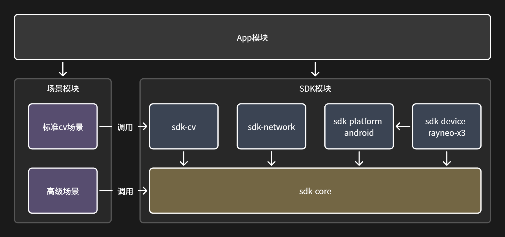
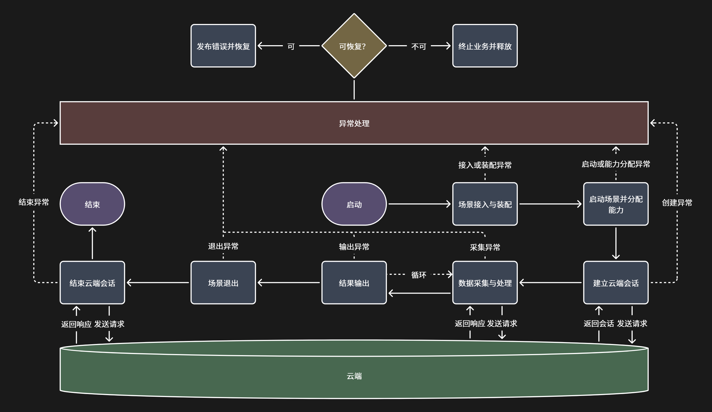

# AR Mahjong Assist

Android 智能眼镜通用智能助手客户端。麻将助手是首个已实现的场景模块，提供云端麻将识别、牌效建议、完整录制和局域网服务联调能力。

## 核心定位

本项目面向 Android 智能眼镜提供通用的智能助手客户端框架。麻将助手不再是客户端主体，而是框架中首个已经实现的场景模块。

## 整体架构



- App 只负责应用壳、场景装配和产品级管理，不包含具体场景业务。
- SDK 提供场景运行、设备能力、通信和通用流程，减少不同场景的重复开发。
- 场景既可以使用标准 CV 流程快速开发，也可以直接使用 SDK 能力自由组织流程。
- 设备能力通过统一接口提供，雷鸟 X3 的专有实现与通用逻辑分离，便于后续适配其他眼镜。
- SDK 内部可以分模块维护，对外仍以一个完整 SDK 交付。

```text
app/                         应用壳、权限、输入、扫码和场景渲染
sdk/sdk-core/                场景生命周期、能力与会话
sdk/sdk-cv/                  标准视觉采集与处理流程
sdk/sdk-network/             网络请求、二维码地址解析与就绪校验
sdk/sdk-platform-android/    Android 能力实现
sdk/sdk-device-rayneo-x3/    RayNeo X3 设备适配
scene-mahjong/               广东麻将业务、录制模式、云端协议和界面
cloud/                       本地麻将分析服务、规则、模型 manifest 和启动脚本
```

## 业务流程



标准 CV 场景和高级场景共享接入、启动、结果与退出流程，只在数据获取和业务执行方式上不同。

麻将场景的主链路为：选择场景并启动会话，SDK 分配相机与网络能力；`sdk-cv` 采集并选取图像帧；`scene-mahjong` 调用服务端分析；结果映射为统一场景结果后由 App 渲染到眼镜；结束时关闭服务端会话并释放设备能力。

## 使用教程

### 准备

1. 使用 Android Studio 打开项目根目录，连接 RayNeo X3，并授予相机权限。
2. 构建并安装 `app` 到眼镜。
3. 在应用中进入“麻将”场景。

### 连接方式

#### 默认云端连接

APK 默认使用内置云端地址。让眼镜连接可访问互联网的 Wi-Fi，进入麻将场景后即可开始对局；无需启动电脑服务端或扫描二维码。

#### 二维码本地连接

本地模式让眼镜访问同一局域网内电脑启动的 `cloud/` 服务。二维码只替换下一次麻将会话的服务地址，结束会话或退出场景后会恢复默认云端地址。

**1. 准备模型和 Python 环境**

模型权重不提交到 Git。将以下两个文件放在仓库同级的 `model/` 目录：

```text
../model/yolo26_hand_detect.pt
../model/yolo26m_mahjong_detect_finetune.pt
```

首次使用时创建环境并安装依赖：

```powershell
conda create -n armahjong-py310 python=3.10 -y
conda activate armahjong-py310
pip install -r .\cloud\requirements.txt
```

`cloud/models/region.ultralytics.local.json` 与 `tile.manifest.json` 已配置为读取这两个模型。默认使用 CUDA `device=0`。

**2. 启动与验证服务**

在仓库根目录执行：

```powershell
.\cloud\start_majiang_server.ps1
```

脚本会检查 Python 与模型文件，随后以 `0.0.0.0:8000` 启动服务。另开一个 PowerShell，确认：

```powershell
Invoke-RestMethod -Uri "http://127.0.0.1:8000/health/ready"
```

返回 `status : ready` 后，查看电脑当前局域网 IPv4 地址，例如 `172.24.111.29`。眼镜与电脑必须连接同一个 Wi-Fi，并且 Windows 防火墙必须允许 TCP 8000 入站。

**3. 生成并扫描二维码**

浏览器打开以下地址，将 `<电脑局域网IP>` 替换为当前地址：

```text
http://<电脑局域网IP>:8000/debug/connect?api_key=local-token
```

页面显示 `Ready` 后，在眼镜麻将场景空闲时单击，扫描该页面二维码。App 会请求二维码中地址的 `/health/ready`；校验通过后再开始对局。

局域网 IP 变化后，旧二维码会指向旧地址，必须重新打开上述页面生成二维码。

本地调试固定使用 `local-token`，无需创建、配置或修改 API key。启动脚本、二维码页面和当前 APK 都已使用该默认值。

### 局内模式

麻将场景空闲时三击，进入开局模式选择：

- **前滑：完整录制**。启动回归录制，自动持续采集并保存整局数据；三击结束并保存。
- **后滑：普通开局**。启动普通实时分析会话；三击结束。

两种模式运行中都会自动采集和分析，无需手动发送图像。双击可返回场景菜单。

## 开发说明

- `cloud/` 是本地服务端子工程，运行数据写入 `cloud/data/`，模型权重使用仓库同级 `model/`，二者均被 Git 忽略。
- `.pt` 模型权重不包含在仓库中；首次运行本地服务前，需要向项目开发者获取 `yolo26_hand_detect.pt` 和 `yolo26m_mahjong_detect_finetune.pt`，并放入仓库同级 `model/` 目录。
- `local.properties`、构建产物、日志和 APK 也不应提交。
- 详细 SDK 抽象与接口说明见 [docs/SDK工程架构与开发接口说明.md](docs/SDK工程架构与开发接口说明.md)。

## 致谢

感谢 Jon Chan 提供的 [Mahjong Dataset](https://universe.roboflow.com/jon-chan-gnsoa/mahjong-baq4s)。

感谢 [FluffyStuff/riichi-mahjong-tiles](https://github.com/FluffyStuff/riichi-mahjong-tiles/tree/master) 提供的麻将 PNG 素材。

感谢 [SYSTRAN/faster-whisper](https://github.com/SYSTRAN/faster-whisper) 提供的快速语音转文本支持。

感谢 [googlefonts/nanoemoji](https://github.com/googlefonts/nanoemoji) 工具支持彩色麻将字体的制作。
