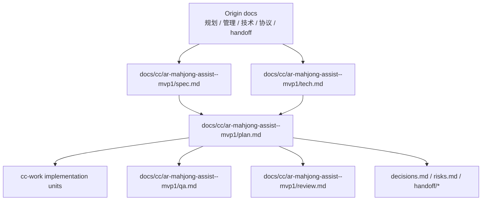
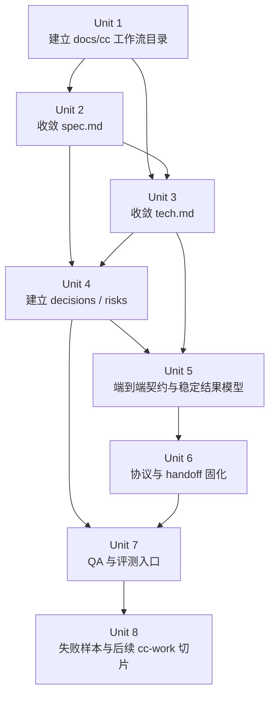

# feat: AR 麻将助手 MVP 执行就绪规划

## 概述

本计划把 AR 麻将助手项目从“已有 Demo、已有多份规划与技术文档”的状态，收敛为可持续执行的工程化工作流。目标不是交付完整 MVP，也不是立即重写功能，而是建立 `docs/cc/ar-mahjong-assist--mvp1/` 下的 source-of-truth 文档、决策记录、风险闭环、测试/QA 入口和后续 `cc-work` 可执行任务边界。

这次计划属于 Deep 级别：它横跨 Android 眼镜端、FastAPI 服务端、YOLO 视觉识别、麻将状态追踪、HTTP/WebSocket 协议、端到端性能预算、数据集评测和项目管理文档治理。

## 问题框架

当前项目已经具备最基础的端到端 Demo：眼镜端采集图像，服务端做 YOLO 识别和牌效建议，再回传到眼镜展示。但现有资料分散在规划文档、MVP 管理文档、技术方案、眼镜协议文档和后端交接说明中，部分结论存在“已完成、待确认、暂定策略、后续建议”混杂的问题。

本计划要解决的是工程化规范问题：把“做什么”“技术上怎么做”“如何执行”“如何验证”“哪些决策未定”分层固化，使后续实现不再靠口头上下文推进。

## 需求追溯

- R1. 建立 `docs/cc/ar-mahjong-assist--mvp1/` 作为本项目 MVP 工作流目录，承载 spec、tech、plan、qa、review、decisions、risks；handoff/contract 类材料按阶段拆出，避免首轮文档过重。
- R2. 将现有规划/管理/技术/协议/handoff 文档收敛为分层 source-of-truth，避免同一结论在多处漂移。
- R3. 明确 MVP 范围：低侵入 AR 展示、图像采集上传、YOLO 识别、手牌/鸣牌结构化、多帧稳定、牌效建议、置信度提示和端到端测试。
- R4. 保留非目标：成熟方案中的 AI 对手建模、完整四家全局建模、赛后复盘、主题/情绪价值、复杂视觉特效、App 端模型部署均不进入本轮工程化落地。
- R5. 将技术待定项转为可追踪决策：最终 YOLO 模型版本、重训策略、单次采集帧数、多帧策略、图片上传/保留策略、低置信度阈值、sessionKey/连接协议。
- R6. 将验收口径转为可执行测试与 QA 入口：识别率、漏检/误检、鸣牌识别、多帧稳定、3-10 秒端到端响应、连续运行稳定性和失败样本回收。
- R7. 为后续 `cc-work` 拆出有依赖顺序、文件边界和测试场景的 implementation units。
- R8. 记录后续 `cc-compound` 知识沉淀入口，但不把完整团队知识库建设作为本轮交付验收项。
- R9. 明确 MVP 用户价值假设：用户能在真实眼镜链路中获得 3-10 秒内可信的出牌建议；当识别不稳定时，用户能明确知道当前建议不可盲信。
- R10. 明确首个产品验证门槛：后续 `cc-work` 的第一批代码任务必须证明真实端到端价值，而不是只完成文档治理。

## 范围边界

- 不直接实现代码，不运行测试，不修改业务逻辑。
- 不在本计划中决定所有模型训练参数；模型结论必须来自评测数据。
- 不把所有历史文档合并成一个大文档；保留原文档作为 origin，新增 `docs/cc/` 工作流层作为执行源。
- 不将本地 Python 调试路径包装成产品路径；MVP 仍以云端/服务端计算、眼镜端轻端为主。
- 不扩展到 Phase 2 的语音交互、赛后复盘、多人场况、对手建模和 UI 主题化。

## 上下文与研究

### 相关代码与模式

- Android 眼镜端主入口集中在 `app/src/main/java/com/example/ai_assist/MainActivity.kt`，目前包含配置态/流式态、Camera2 采集、自动 capture loop、上传状态、防重复上传、WebSocket 建议流、音频录制入口和 RayNeo touch action 处理。
- 二维码配置入口在 `app/src/main/java/com/example/ai_assist/QrScanActivity.kt`，配置持久化与解析由 `app/src/main/java/com/example/ai_assist/storage/ConnectionConfigStore.kt` 承担。
- Android 默认连接常量在 `app/src/main/java/com/example/ai_assist/AppConfig.kt`，仍存在硬编码 `SERVER_BASE_URL`，但运行链路已经通过二维码配置支持动态连接。
- 服务端入口集中在 `server/main.py`，包含 `/api/start-session`、`/api/analyze-hand`、`/api/end-session`、mock QR 配置、mock WebSocket suggestions、上传目录和全局 session trackers。
- 响应模型位于 `server/schemas.py`，当前 `AnalyzeResponse` 已包含 `user_hand`、`melded_tiles`、`suggested_play`、`annotated_image_path`、`action_detected`、`warning`、`is_stable`。
- 视觉识别封装在 `server/vision_service.py`，底层模型入口在 `server/yolo_inference.py`，模型资产位于 `server/models/yolo/`。
- 麻将状态追踪在 `server/mahjong_state_tracker.py`，牌效建议在 `server/efficiency_engine.py`。
- 服务端测试集中在 `server/tests/`，已覆盖 API 转换、吃碰杠、听牌/牌效、tracker 逻辑和集成 melds。
- Android 构建使用 Kotlin + XML ViewBinding、Gradle Kotlin DSL、AGP `8.13.2`、Kotlin `2.0.21`、Java 11、`compileSdk/targetSdk 36`、`minSdk 31`；RayNeo Mercury SDK 通过 `app/libs/MercuryAndroidSDK-v0.2.3-20260104184638_9002bcc8.aar` 本地 AAR 引入。
- 服务端使用 Python 3.9+、FastAPI/Uvicorn/Pydantic、SQLite、pytest/ruff、Dockerfile 与 `docker-compose.yml`；视觉链路使用 ONNXRuntime、OpenCV、supervision、Pillow 和 YOLOv8 ONNX 权重。
- 调试入口包括 `server/static/dashboard.html`、`server/static/mock_qr.html`、`server/static/yolo_debug.html`。

### 组织积累的经验

- 本轮规划前仓库没有 `docs/cc/`，也未发现 `docs/cc/compounds/` 工作流沉淀目录。本计划应把本轮工程化规范作为第一条可复用工作流沉淀入口，但知识库建设只记录入口，不进入 MVP 执行阻塞项。
- 已有 `docs/AR_GLASSES_ARCHITECTURE_AND_PROTOCOL.md` 和 `docs/SERVER_HANDOFF_TO_BACKEND_CN.md`，说明端云协议与后端交接已经是项目关键协作面，应进入 decisions / handoff 管理。
- 可复用经验当前散落在项目文档中：MVP 应聚焦“眼镜采集 -> 云端视觉识别 -> 手牌/鸣牌结构化 -> 多帧稳定 -> 建议 -> 轻端展示”，麻将是 CV 能力验证载体，不扩展成完整麻将游戏平台。
- 现有文档已经形成隐含分工：规划讲目标/边界，管理讲节奏/风险/验收，技术讲链路/接口/验证/迁移，协议文档讲眼镜端与后端对齐，handoff 文档讲可复用改动与不该交接的本地产物。
- 后端运行经验显示，持续采样主要风险不是瞬时并发，而是上传文件持续落盘膨胀；已有策略是保留最近 24 小时、最多 1500 文件并周期清理。

### 外部参考资料

- 本轮规划不额外查外部资料。理由：用户提供了明确项目路径和完整本地文档，仓库中已有实际实现、测试和协议说明；当前问题是内部工程化收敛，而不是选择新技术栈。

## 关键技术决策

- `docs/cc/ar-mahjong-assist--mvp1/` 作为新增工作流目录：这样不破坏已有文档，又能给 `cc-work`、`cc-qa`、`cc-review` 提供稳定入口。
- 以现有 Markdown 文档为 origin，不直接覆盖：现有文档包含历史判断、交接语境和阶段口径，直接覆盖会丢失脉络。
- 先做文档/契约规范，再做业务代码改造：当前最大风险是需求、技术方案、协议和验收口径不一致，直接写代码会放大漂移。
- 将协议和评测纳入 plan 的第一批执行单元：AR 项目的成功不只取决于模型效果，还取决于端云 contract、失败状态、延迟预算和低置信度展示。
- feature-bearing units 默认 test-first：服务端已有 `server/tests/`，后续行为变化应先补测试或 characterization 覆盖。
- HTTP 上行 + WebSocket 下行作为当前协议收敛方向：会话、图片和音频仍走 HTTP；建议、状态、警告推送走 WebSocket。若正式后端暂未接入，mock 通道必须继续标记为调试能力而非产品契约。
- 用户价值优先于文档完备度：阶段 2 之后即可评估是否启动最小产品验证任务，不必等所有 handoff/治理材料都完成。
- 安全与隐私作为发布前阻塞项：sessionKey 语义、WebSocket 访问控制、图片/音频/日志保留策略、静态调试页暴露边界必须先进入 decisions/risks，再进入实现。

## 待定问题

### 已在规划中解决

- 是否先改代码：不先改。先建立 `docs/cc` 工作流层与决策/风险/QA 入口。
- 是否把成熟方案全部纳入 MVP：不纳入。本计划仅覆盖 Q3/MVP 核心链路。
- 是否保留已有文档：保留，并把它们作为 origin documents 引用。

### 延迟到实现阶段

- 具体 YOLO 阈值、模型版本、重训策略：必须基于统一评测集结果决定。
- 单次采集几帧、多帧策略采用投票/最优帧/混合：需要真实连续帧数据验证。
- 低置信度阈值：需要基于识别置信度分布和建议质量人工标注确定。
- Android 端是否拆分 `MainActivity.kt`：计划中会标记为 characterization-first，实际拆分边界需要先看测试与编译反馈。
- Android 端“上传前裁剪/旋转”和服务端“二次 top/bottom 切图”的区域语义是否一致：需要先进入 tech.md 和 evaluation.md 建模，再由后续实现任务验证。
- 服务端 session 状态是否要迁移出全局内存：MVP 单实例可接受，但云端/多 worker 发布前必须重新决策。
- `sessionKey` 是鉴权 key、固定会话 id 还是配置标识：需要先在 decisions.md 做产品/安全决策，再进入协议实现。
- HTTP 响应和 WebSocket 下行谁是展示权威源：MVP 可以先规定 HTTP 为分析结果权威、WebSocket 为状态/建议推送通道，但正式实现前要在 tech.md 固化冲突处理。
- 识别率 >80% 的计算口径：需要在 evaluation.md 区分单牌准确率、整手牌完全正确率和可用建议局数比例。
- MVP 是否启用音频/STT：若启用，必须定义用户触发/提示、最大时长、传输与存储、转写保留、第三方 STT 边界、密钥与日志脱敏；若不启用，应在 spec.md/tech.md 显式标记为 disabled 或 local-only。
- sessionKey 安全语义：需要定义熵、生成方、TTL、session/device 绑定、传输方式、重放防护、end-session 失效和日志脱敏。
- 上传图片与调试产物保留策略：需要区分 raw image、annotated image、failure sample、response、logs、static debug pages 的权限、保留周期、清理触发和匿名化规则。

## 高层技术设计

> *这里展示的是预期方案的方向性指导，供 review 参考，不是实现规格。执行 agent 应把它当作上下文，而非要复制的代码。*

## 实现单元

- [ ] **单元 1：建立 `docs/cc` 工作流目录**

**目标：** 创建 AR 麻将助手 MVP 的稳定 workflow 根目录，并保留原始文档来源索引。

**需求：** R1, R2, R7, R8

**依赖：** 无

**文件：**
- 新建：`docs/cc/ar-mahjong-assist--mvp1/README.md`
- 新建：`docs/cc/ar-mahjong-assist--mvp1/sources.md`
- 新建：`docs/cc/ar-mahjong-assist--mvp1/review.md`
- 更新：`docs/cc/ar-mahjong-assist--mvp1/plan.md`

**方案：**
- 当前状态：`plan.md` 已由本轮 `cc-plan` 创建，后续执行此单元时应把它视为 existing draft，并根据 review 继续更新。
- 在 README 中说明本目录是 workflow source-of-truth，不替代历史 origin docs。
- 在 sources.md 中列出每份 origin 文档的用途、当前权威程度和需要迁移/对齐的章节。
- 在 review.md 中记录本轮 plan review findings、处理结果和保留问题，作为后续 `cc-review` / `cc-document-review` 的衔接点。
- 在 README 中记录后续可用 `cc-compound` 沉淀复杂问题，但不把 compounds 目录建设作为当前 MVP 验收项。
- plan.md 保持本计划作为执行入口。
- 所有新增 Markdown 文件必须保存为 UTF-8，并在 Windows PowerShell/WSL 中分别做一次中文可读性检查，避免把终端编码问题误判为文件乱码。

**执行备注：** direct -- 纯文档脚手架，不改变运行行为。

**遵循的模式：**
- 现有文档命名风格参考 `docs/AR_MAHJONG_MVP_PROJECT_MANAGEMENT.md`、`docs/AR_MAHJONG_MVP_TECHNICAL_DESIGN.md`。

**测试场景：**
- Test expectation: none -- 纯文档目录与索引，无运行行为变化。

**验证：**
- `docs/cc/ar-mahjong-assist--mvp1/` 存在，且 README/sources/plan/review 能清楚说明文档分层、来源和 review 状态。
- `plan.md`、`README.md`、`sources.md`、`review.md` 中中文文本在 UTF-8 读取下无 mojibake。

- [ ] **单元 2：收敛 MVP 产品规格 `spec.md`**

**目标：** 将 Q3 规划和 MVP 管理文档中的“做什么、为什么做、做成什么算成功”固化为 `spec.md`。

**需求：** R2, R3, R4

**依赖：** 单元 1

**文件：**
- 新建：`docs/cc/ar-mahjong-assist--mvp1/spec.md`
- 修改：`docs/cc/ar-mahjong-assist--mvp1/sources.md`

**方案：**
- spec.md 只回答 WHAT：用户场景、MVP 目标、非目标、成功标准、阻塞问题。
- 明确区分“Q3 MVP”和“成熟方案设想”，避免 AI 对手建模、复盘、主题设计等进入当前执行范围。
- 将验收标准写成可验证结果：实机链路、识别率、端到端响应、完整对局、已知限制清单。
- 写入两条产品价值假设：一是新手/辅助用户能在 3-10 秒内获得可信出牌建议，二是低置信度/不稳定时用户能理解“不应盲信当前建议”。
- 补齐用户 flow：首次扫码配置、开始对局、自动采集/上传/建议、低置信度重试、WebSocket 降级、隐藏/刷新建议、结束会话。
- 定义低侵入 AR 展示原则：默认 idle、不遮挡牌面、建议出现位置/持续时间、低置信度提示、错误提示、RayNeo touch action 语义和哪些状态绝不常驻遮挡。

**遵循的模式：**
- 内容来源参考 `docs/Q3_MVP_PLAN.md` 和 `docs/AR_MAHJONG_MVP_PROJECT_MANAGEMENT.md`。

**测试场景：**
- Happy path：读者只看 spec.md，就能判断一个新需求是否属于 MVP 范围。
- Edge case：成熟方案中的非 MVP 能力被提出时，spec.md 能给出明确排除或 deferred 归类。
- Integration：spec.md 的成功标准能被后续 qa.md 和 plan.md 引用，不需要回查多个历史文档。

**验证：**
- spec.md 覆盖 MVP 包含/不包含、成功标准、用户 flow 和验收口径，且没有写实现方案。

- [ ] **单元 3：收敛技术方案 `tech.md`**

**目标：** 将现有技术方案和眼镜协议文档收敛为 `cc-tech` 风格的技术契约。

**需求：** R2, R3, R5, R6

**依赖：** 单元 1、单元 2

**文件：**
- 新建：`docs/cc/ar-mahjong-assist--mvp1/tech.md`
- 修改：`docs/cc/ar-mahjong-assist--mvp1/sources.md`

**方案：**
- tech.md 只回答 HOW-tech：端云架构、数据流、接口契约、响应模型、状态生命周期、评测设计、非功能指标。
- 把“已确定”和“未确定”拆开；未确定项必须链接到 decisions.md 或 risks.md。
- 对齐 `server/schemas.py`、`server/main.py`、Android 配置/流式消费逻辑与 `docs/AR_GLASSES_ARCHITECTURE_AND_PROTOCOL.md`。
- 在 tech.md 中建立端到端 contract 章节，若内容膨胀再拆出 contracts.md；该章节必须包含 HTTP response、WebSocket payload、`server/schemas.py`、Android `AnalyzeResponse.kt` 的 current/proposed 字段矩阵。
- 定义 UI/链路状态机：`idle`、`capturing`、`uploading`、`analyzing`、`waiting_ws`、`result_ready`、`stale_result`、`retrying`、`failed`，并说明每个状态的显示、超时、恢复和日志记录。

**遵循的模式：**
- 技术内容来源参考 `docs/AR_MAHJONG_MVP_TECHNICAL_DESIGN.md`。
- 协议内容来源参考 `docs/AR_GLASSES_ARCHITECTURE_AND_PROTOCOL.md`。

**测试场景：**
- Happy path：实现者能从 tech.md 找到端到端链路的每个边界输入/输出。
- Edge case：低置信度、识别失败、WebSocket 未连接、session 不存在、上传文件保存失败都有归属说明。
- Integration：tech.md 中的接口契约能映射到 `server/schemas.py` 和 Android 端消费字段。

**验证：**
- tech.md 不重复项目排期，且能作为后续服务端/API/Android 改造的技术源头。

- [ ] **单元 4：建立决策和风险闭环**

**目标：** 把技术待定项和项目风险转为可追踪、可关闭的工程对象。

**需求：** R5, R6, R7

**依赖：** 单元 2、单元 3

**文件：**
- 新建：`docs/cc/ar-mahjong-assist--mvp1/decisions.md`
- 新建：`docs/cc/ar-mahjong-assist--mvp1/risks.md`
- 修改：`docs/cc/ar-mahjong-assist--mvp1/tech.md`

**方案：**
- decisions.md 跟踪：WebSocket 是否作为正式下行、sessionKey 如何传、图片上传格式、图片保留策略、低置信度阈值、多帧策略、模型路线。
- risks.md 跟踪：定焦/虚焦、弱光/反光、识别率不足、鸣牌漏检、端到端延迟、服务端吞吐、Android 裁剪与服务端切图语义偏差、server 全局 session 多实例风险、README/文档编码漂移、人力和排期。
- 每个决策项包含 owner/status/evidence/decision/date/impact；每个风险包含 likelihood/impact/trigger/mitigation/verification。

**遵循的模式：**
- 风险来源参考 `docs/Q3_MVP_PLAN.md`、`docs/AR_MAHJONG_MVP_PROJECT_MANAGEMENT.md`。
- 协议开放项来源参考 `docs/AR_GLASSES_ARCHITECTURE_AND_PROTOCOL.md`。

**测试场景：**
- Happy path：某个待定项被关闭后，decisions.md 能说明证据和影响。
- Edge case：一个风险无法在本阶段关闭时，risks.md 能保留触发条件和降级策略。
- Integration：plan.md 的实现单元不再散落未决技术判断，而是引用 decisions.md。

**验证：**
- 所有现有技术文档中的“未确定/待验证/待确认”都有对应 decision 或 risk 条目。

- [ ] **单元 5：定义端到端契约与稳定结果模型**

**目标：** 在进入协议实现前，先固定二维码配置、session 绑定、HTTP/WS 职责、响应 schema、稳定性、置信度模型和发布前安全边界。

**需求：** R3, R5, R6, R7

**依赖：** 单元 3、单元 4

**文件：**
- 新建：`docs/cc/ar-mahjong-assist--mvp1/contracts.md`
- 修改：`docs/cc/ar-mahjong-assist--mvp1/decisions.md`
- 修改：`docs/cc/ar-mahjong-assist--mvp1/tech.md`

**方案：**
- contracts.md 定义二维码字段、session id/sessionKey 关系、HTTP 分析响应、WebSocket 推送优先级、低置信度和 warning 的展示策略。若团队选择更小的 P0 文档集，本单元内容可先作为 tech.md 的 contract 章节落地，contracts.md 延后拆出。
- 规划稳定结果模型，至少覆盖 `frame_id`、`session_id`、`confidence`、`is_stable`、`warning`、`accepted_state`、`raw_detections`、`annotated_image_path`。
- 明确多帧稳定是 N 帧共识、tile confidence 投票、最优帧还是状态机异常拒绝；若本阶段未定，写成 decision blocker。
- 明确 ROI 职责：Android 上传完整画面由服务端切 ROI，或 Android 上传标准化 ROI 后服务端不再二次切。当前双重裁剪风险必须进入 risk。
- 建立字段迁移矩阵：HTTP response、WebSocket payload、`server/schemas.py`、Android `AnalyzeResponse.kt` 当前字段、目标字段、兼容策略和是否需要代码改动。
- 将 sessionKey、WebSocket access control、上传图片/标注图/日志/静态调试页、`.env` 与二维码中的敏感信息纳入 security blockers。
- 明确静态 debug pages：`dashboard.html`、`mock_qr.html`、`yolo_debug.html` 在生产环境默认关闭或需要鉴权，mock 端点不得作为正式协议暴露。

**遵循的模式：**
- `app/src/main/java/com/example/ai_assist/model/AnalyzeResponse.kt`
- `app/src/main/java/com/example/ai_assist/storage/ConnectionConfigStore.kt`
- `server/schemas.py`
- `server/main.py`

**测试场景：**
- Happy path：扫码配置后，HTTP 和 WebSocket 对同一 session 返回一致或有明确优先级的建议状态。
- Edge case：WebSocket 断连但 HTTP 分析成功时，UI 仍能展示权威结果并标明流式状态。
- Error path：低置信度、缺牌、幽灵牌、session 不存在、上传失败都能在响应 schema 中表达。
- Integration：Android response model、服务端 Pydantic schema、协议文档三者字段一致。

**验证：**
- contracts.md 能让后续实现者不再猜 session、ROI、confidence、stable state 和 HTTP/WS 职责。

- [ ] **单元 6：固化协议与交接 handoff**

**目标：** 将眼镜端/后端协议与后端交接说明纳入 workflow，形成可对齐、可评审的 handoff 材料。

**需求：** R2, R3, R5, R7

**依赖：** 单元 5

**文件：**
- 新建：`docs/cc/ar-mahjong-assist--mvp1/handoff/glasses-protocol.md`
- 新建：`docs/cc/ar-mahjong-assist--mvp1/handoff/backend.md`
- 修改：`docs/cc/ar-mahjong-assist--mvp1/contracts.md`

**方案：**
- contracts.md 或 tech.md#contract 是协议权威源；handoff 文档只说明消费者视角、迁移步骤、替换点和交接注意事项，不重新定义字段。
- glasses-protocol.md 提炼二维码 JSON、HTTP 上行、WebSocket 下行、错误 payload、sessionKey 传递和客户端状态逻辑。
- backend.md 提炼后端可复用内容、不可直接复用内容、上传文件保留策略、STT 延迟初始化、mock/正式接口切换。
- 将正式协议和 mock 调试能力明确区分，避免 mock payload 被误当成产品契约。
- 明确二维码 JSON 至少覆盖 `serverUrl`、可选 `streamUrl`、`fps`、`sessionKey`、`label`；正式下行 payload 后续应补齐 `seq`、`frame_ts`、`confidence`、`warning` 等字段决策。

**遵循的模式：**
- `docs/AR_GLASSES_ARCHITECTURE_AND_PROTOCOL.md`
- `docs/SERVER_HANDOFF_TO_BACKEND_CN.md`
- `server/main.py` 中 mock QR、WebSocket、session 和 upload handling 的现状。

**测试场景：**
- Happy path：后端同学只看 handoff/backend.md，就能知道哪些代码可复用、哪些只是参考。
- Edge case：正式 WebSocket 未接入时，handoff 能说明 mock 通道边界和替换点。
- Integration：眼镜端二维码配置字段、服务端 mock config、WebSocket payload 三者命名一致或差异被显式记录。

**验证：**
- handoff 文档能被团队作为对齐材料使用，不需要从多份历史文档中拼上下文。

- [ ] **单元 7：建立 QA 与评测入口**

**目标：** 把识别、建议、端到端链路和实机稳定性验收转为 `qa.md` 与评测清单。

**需求：** R3, R6, R7

**依赖：** 单元 2、单元 3、单元 4、单元 5、单元 6

**文件：**
- 新建：`docs/cc/ar-mahjong-assist--mvp1/qa.md`
- 新建：`docs/cc/ar-mahjong-assist--mvp1/evaluation.md`
- 修改：`docs/cc/ar-mahjong-assist--mvp1/risks.md`

**方案：**
- qa.md 定义 Quick/Standard/Exhaustive 三档测试目标，映射后续 `cc-qa`。
- evaluation.md 定义数据集、标注粒度、指标、失败样本库、连续帧序列和端到端耗时拆分；若首轮范围收缩，可先作为 qa.md 的 evaluation 章节落地。
- 将已有 `server/synthetic_tests/`、`server/test_variants/` 和 `server/tests/` 纳入评测资产清单。
- 将“15 分钟连续一局”、整手牌准确率 >80%、多帧稳定性优于单帧 baseline、P95 端到端耗时、人工纠正次数和错误建议率写入 QA 指标。
- 明确标注依赖：annotation 格式、owner、最小样本量、bbox/tile ground truth 路径；若当前没有 detection-level 标注，则按整手牌/建议可用性先验收，并将 per-box mAP 类指标 deferred。
- QA 覆盖 AR 展示状态：低置信度、warning、stale result、retrying、failed、WebSocket 断连、HTTP 成功但 WS 不可用、session 结束后的显示清理。

**遵循的模式：**
- 技术评测方案参考 `docs/AR_MAHJONG_MVP_TECHNICAL_DESIGN.md`。
- 测试验证体系参考 `docs/AR_MAHJONG_MVP_PROJECT_MANAGEMENT.md`。
- 测试代码参考 `server/tests/`。

**测试场景：**
- Happy path：标准 QA 能覆盖创建会话、采集上传、识别、建议返回、眼镜展示、结束会话。
- Edge case：弱光、反光、倾斜、遮挡、连续帧波动、鸣牌、副露、低置信度都能进入评测清单。
- Error path：上传失败、session 不存在、模型不可用、WebSocket 断连、后端超时有记录和预期用户提示。
- Integration：服务端 pytest、视觉评测脚本、实机测试记录可以被同一 qa.md 汇总。

**验证：**
- qa.md 能作为后续 `cc-qa` 的入口，evaluation.md 能指导模型/识别链路是否达标。

- [ ] **单元 8：失败样本流与后续 `cc-work` 执行切片**

**目标：** 基于规范化文档，形成后续实现阶段的候选工作包，并把低置信度/失败样本闭环列为优先方向。

**需求：** R6, R7, R8

**依赖：** 单元 1-7

**文件：**
- 新建：`docs/cc/ar-mahjong-assist--mvp1/work-items.md`
- 可选新建：`docs/cc/ar-mahjong-assist--mvp1/failure-samples.md`
- 修改：`docs/cc/ar-mahjong-assist--mvp1/plan.md`

**方案：**
- 失败样本格式可先写入 qa.md；当样本量和责任人稳定后，再拆出 failure-samples.md。记录低置信度、warning、识别失败、错误建议，并关联原图/标注图/response/confidence/人工标签/后续处理状态。
- work-items.md 只列后续 `cc-work` 候选包，例如：协议契约对齐、上传失败中断、低置信度响应、评测脚本、Android MainActivity 拆分、README/中文字符串编码修复、异常 0 字节文件清理、依赖管理统一、CI/测试入口。
- 每个候选包标明依赖、风险、目标文件和建议使用的 skill：`cc-tdd`、`cc-fix`、`cc-qa` 或 `cc-review`。
- 对 `MainActivity.kt` 这类大文件改造标记 characterization-first，避免无保护重构。
- 首个 `cc-work` 产品验证候选包应优先证明真实端到端价值：实机采集 -> 服务端识别 -> 建议返回 -> AR 低侵入显示；文档治理不应长期排在用户价值验证之前。

**遵循的模式：**
- 后续执行应参考 `server/tests/` 现有测试风格。
- Android 端改动应保持 RayNeo SDK、Camera2 和配置/流式状态边界清晰。

**测试场景：**
- Happy path：执行者能从 work-items.md 选择一个边界清晰的任务进入 `cc-work`。
- Edge case：某个任务跨 Android 与 server 时，work-items.md 明确标记 coupled cluster，不伪装成可并行。
- Integration：work-items.md 中每个 feature-bearing item 都能追溯到 spec/tech/qa/decision/risk 中至少一个来源。

**验证：**
- 后续实现不需要重新阅读所有历史文档，就能从 work-items.md 和 plan.md 进入执行。

## 系统级影响

- **交互图：** 本计划影响文档流、实现流、QA 流和交接流，但不改变运行时代码。
- **错误传播：** 后续执行需要统一识别失败、低置信度、上传失败、WebSocket 断连和 session 不存在的错误口径。
- **状态生命周期风险：** 现有全局 session tracker、上传目录保留、WebSocket latest result、Android streaming/config 状态都需要在 tech/qa 中被显式建模。
- **API 接口一致性：** `server/schemas.py`、`server/main.py`、Android 端 response consumption、协议 handoff 文档必须一致。
- **集成覆盖：** 单元测试无法证明 AR 眼镜实机链路；必须保留实机 QA 与端到端耗时记录。
- **不变量确认：** 本计划不直接改变 `/api/start-session`、`/api/analyze-hand`、`/api/end-session`、mock WebSocket 或 Android UI 行为。

## 风险分析与缓解

| 风险 | 可能性 | 影响 | 缓解措施 |
|------|--------|------|----------|
| 文档分层后团队仍回到旧文档改结论 | 中 | 高 | sources.md 标明 origin 与 workflow source-of-truth；新决策只进 decisions.md |
| spec/tech/plan 混写，导致执行者仍不清楚边界 | 中 | 高 | 每份文档限定职责：WHAT / HOW-tech / HOW-exec |
| 模型指标无统一数据集，争论无法关闭 | 高 | 高 | evaluation.md 先定义数据集、指标和失败样本库 |
| 协议 mock 与正式 contract 混用 | 中 | 高 | handoff/glasses-protocol.md 明确 mock/正式字段边界 |
| Android `MainActivity.kt` 过大，后续改造容易回归 | 高 | 中 | work-items.md 标记 characterization-first，先补覆盖再拆 |
| README 或文档编码漂移继续影响协作 | 中 | 中 | 将编码修复列为后续文档治理 work item |
| 服务端全局状态在多 session/长时间运行下不稳定 | 中 | 高 | tech.md 和 qa.md 记录 session lifecycle、retention 和连续运行测试 |
| sessionKey / WebSocket 缺少访问控制语义 | 中 | 高 | decisions.md 定义 sessionKey 安全语义，tech.md 固化 WS token/session 校验 |
| 图片、音频、调试产物保留策略不清 | 中 | 高 | risks.md 建立数据保留矩阵，qa.md 验证清理与日志脱敏 |
| 静态 debug pages 在生产环境暴露 | 中 | 高 | tech.md 标记生产默认关闭或鉴权，handoff 标明 mock/debug 非正式能力 |

## 分阶段交付

### 阶段 1：工作流目录与源文档索引

- 完成单元 1。
- 产出 README、sources、review 和当前 plan。

### 阶段 2：source-of-truth 收敛

- 完成单元 2、3、4。
- 产出 spec、tech、decisions、risks。
- 阶段 2 完成后做一次产品价值 gate：判断是否可以启动最小端到端验证任务，而不是等待所有治理材料。

### 阶段 3：协议、交接与 QA

- 完成单元 5、6、7。
- 产出 contract 章节或 contracts.md、handoff、qa、evaluation 章节或 evaluation.md。

### 阶段 4：进入执行

- 完成单元 8。
- 从 work-items.md 选择首个 `cc-work` 任务，建议优先级为：协议契约对齐、QA/评测入口、上传失败/低置信度错误口径、Android characterization。

## 文档计划

- 新增 `docs/cc/ar-mahjong-assist--mvp1/` 工作流目录。
- 保留 `docs/Q3_MVP_PLAN.md`、`docs/AR_MAHJONG_MVP_PROJECT_MANAGEMENT.md`、`docs/AR_MAHJONG_MVP_TECHNICAL_DESIGN.md`、`docs/AR_GLASSES_ARCHITECTURE_AND_PROTOCOL.md`、`docs/SERVER_HANDOFF_TO_BACKEND_CN.md` 作为 origin，不直接删除或覆盖。
- 后续当 `cc-work` 关闭复杂问题时，可用 `cc-compound` 沉淀到 `docs/cc/compounds/`。

## 运维 / 发布说明

- 本计划不触发发布，不改变 APK、服务端镜像或接口行为。
- 后续执行阶段若改动 `server/main.py`、`server/schemas.py` 或 Android 网络配置，需要同步 QA 端到端检查和 handoff 文档。

## 来源与参考资料

- **规划文档：** `docs/Q3_MVP_PLAN.md`
- **项目管理：** `docs/AR_MAHJONG_MVP_PROJECT_MANAGEMENT.md`
- **技术方案：** `docs/AR_MAHJONG_MVP_TECHNICAL_DESIGN.md`
- **协议文档：** `docs/AR_GLASSES_ARCHITECTURE_AND_PROTOCOL.md`
- **后端交接：** `docs/SERVER_HANDOFF_TO_BACKEND_CN.md`
- **Android 入口：** `app/src/main/java/com/example/ai_assist/MainActivity.kt`
- **二维码入口：** `app/src/main/java/com/example/ai_assist/QrScanActivity.kt`
- **服务端入口：** `server/main.py`
- **响应模型：** `server/schemas.py`
- **视觉服务：** `server/vision_service.py`
- **状态追踪：** `server/mahjong_state_tracker.py`
- **服务端测试：** `server/tests/`
