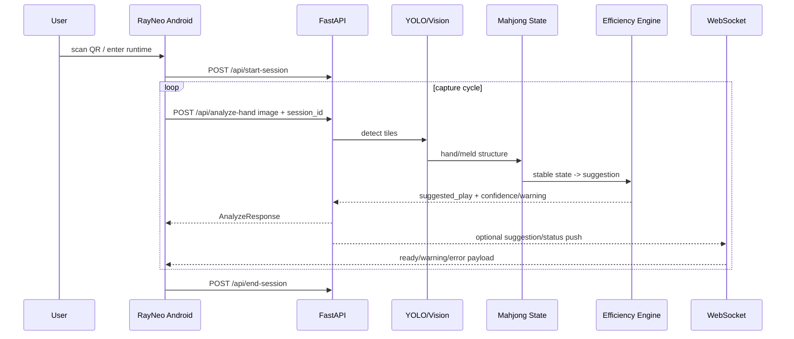

# AR 麻将助手 MVP 技术方案

## 1. 技术定位

本文件是 `cc-tech` 风格的技术 source-of-truth，回答 AR 麻将助手 MVP1 在技术上如何收敛。它不重复项目排期，也不替代 `spec.md` 的产品范围。

当前技术主路：

```text
RayNeo 眼镜 Android 轻端
  -> HTTP 上传图片 / 会话控制
  -> FastAPI 服务端
  -> YOLO ONNX 识别
  -> 手牌/鸣牌结构化
  -> 多帧稳定判断
  -> 规则配置驱动的手牌效率建议
  -> HTTP 响应 + 可选 WebSocket 下行
  -> AR 低侵入展示
```

## 2. 当前架构现状

### Android 眼镜端

- 主入口：`app/src/main/java/com/example/ai_assist/MainActivity.kt`
- 二维码入口：`app/src/main/java/com/example/ai_assist/QrScanActivity.kt`
- 配置解析：`app/src/main/java/com/example/ai_assist/storage/ConnectionConfigStore.kt`
- 分析响应模型：`app/src/main/java/com/example/ai_assist/model/AnalyzeResponse.kt`
- 构建栈：Kotlin、XML ViewBinding、Gradle Kotlin DSL、AGP `8.13.2`、Kotlin `2.0.21`、Java 11、SDK 36/31。
- RayNeo SDK：本地 AAR `app/libs/MercuryAndroidSDK-v0.2.3-20260104184638_9002bcc8.aar`。

当前客户端已支持二维码动态连接、持续采样、HTTP 图片上传、可选 WebSocket 建议流、配置态/运行态切换和基础 touch action。

### 服务端

- 入口：`server/main.py`
- Schema：`server/schemas.py`
- 视觉服务：`server/vision_service.py`
- YOLO 推理：`server/yolo_inference.py`
- 状态追踪：`server/mahjong_state_tracker.py`
- 牌效建议：`server/efficiency_engine.py`
- 测试：`server/tests/`
- 栈：Python 3.9+、FastAPI、Uvicorn、Pydantic、SQLite、pytest、ruff、ONNXRuntime、OpenCV、Pillow。

当前服务端暴露 `/api/start-session`、`/api/analyze-hand`、`/api/process-audio`、`/api/end-session`、history/debug 接口和 mock WebSocket。

## 3. 端到端数据流



HTTP 分析响应是 MVP1 内部演示主链路权威来源；WebSocket 是本地调试和后续下行通道候选，不作为 MVP1 runtime acceptance 的必要路径。若未来正式后端确定 WebSocket 为强契约，需要在 `decisions.md` 中关闭该决策并同步 Android/server 字段。

MVP1 默认规则为广东麻将。服务端建议模块应通过规则 profile 获取规则差异，避免把广东麻将判断硬编码到识别或 Android 展示层。

## 4. 当前 API 契约

### 4.1 开始会话

```http
POST /api/start-session
```

Request:

```json
{
  "session_id": "uuid-string"
}
```

Response:

```json
{
  "status": "success",
  "session_id": "uuid-string"
}
```

### 4.2 分析图片

```http
POST /api/analyze-hand
Content-Type: multipart/form-data
```

Current fields:

- `image`: JPEG image
- `session_id`: string
- `incoming_tile`: optional string
- `rule_profile`: optional string, default `guangdong`

Current server response:

```json
{
  "user_hand": ["1m", "2m", "3m"],
  "melded_tiles": ["4p", "5p", "6p"],
  "suggested_play": "切 8m",
  "annotated_image_path": "/static/uploads/xxx.jpg",
  "action_detected": null,
  "warning": null,
  "is_stable": true
}
```

### 4.3 音频处理

```http
POST /api/process-audio
Content-Type: multipart/form-data
```

音频/STT 当前存在接口和 Android 入口，但 MVP 产品范围默认不启用语音交互。若后续启用，必须先关闭隐私、安全和用户提示决策。

### 4.4 结束会话

```http
POST /api/end-session
```

Request:

```json
{
  "session_id": "uuid-string"
}
```

## 5. 二维码配置契约

当前 Android 支持本地调试 JSON:

```json
{
  "version": 1,
  "serverUrl": "http://192.168.2.195:8000/",
  "streamUrl": "ws://192.168.2.195:8000/ws/mock-suggestions/default",
  "fps": 1,
  "sessionKey": "optional-token",
  "label": "本地模拟服务"
}
```

字段规则：

| 字段 | 当前状态 | MVP1 约束 |
|---|---|---|
| `version` | optional, default 1 | 保留，便于后续兼容 |
| `serverUrl` | required | HTTP 基地址，客户端自动补 `/` |
| `streamUrl` | optional | WebSocket 下行地址，缺失时 HTTP 仍可工作 |
| `fps` | optional, coerced 1..5 | 默认 1 fps，后续需结合耗时和服务端压力调参 |
| `sessionKey` | parsed and stored only | 当前不是鉴权凭据；使用前必须定义安全语义 |
| `label` | optional | 仅用于环境显示 |

MVP1 约束：

- QR 扫描形式只用于本地调试和内部演示环境切换，不作为对外用户连接方案。
- `http://`、`ws://` 仅允许在受控本地网络或隔离演示网络中使用。
- 对外演示或生产化前，必须改为 HTTPS/WSS 或等价受保护通道，并定义 QR host allowlist、环境确认和 token 过期策略。

## 6. Contract 字段迁移矩阵

| 能力 | Server current `server/schemas.py` | Android current `AnalyzeResponse.kt` | Target contract | 兼容策略 |
|---|---|---|---|---|
| hand tiles | `user_hand: List[str]` | `userHand: List<String>` | 保留 | 无需破坏性变更 |
| meld tiles | `melded_tiles: List[str]` | `meldedTiles: List<String>` | 保留兼容，同时新增可选 `melds: [{type, tiles}]` | MVP1 若要验收吃/碰/杠类型，必须消费 `melds`；否则只验收鸣牌牌面 |
| suggestion | `suggested_play: str` | `suggestedPlay: String` | 保留，语义收窄为 hand-efficiency suggestion | 新增 optional `suggestion_confidence` |
| rule profile | absent | absent | `rule_profile`, default `guangdong` | 新增 optional 字段；缺失时走广东麻将 |
| annotated image | `annotated_image_path?: str` | not consumed | 调试环境可用，生产默认不直接暴露 | Android 可暂不消费 |
| action | `action_detected?: str` | not consumed | 可选，后续用于摸牌/吃碰杠状态 | optional |
| warning | `warning?: str` | not consumed | MVP1 记录，不要求专门 UI | Android 后续增加 optional 字段 |
| stable | `is_stable: bool` | not consumed | MVP1 记录，不要求专门 UI | Android 后续增加 optional 字段 |
| recognition confidence | absent | absent | `recognition_confidence` | 新增 optional 字段 |
| suggestion confidence | absent | absent | `suggestion_confidence` | 新增 optional 字段 |
| sequence/frame | absent | absent | MVP required: response freshness uses `session_id` + monotonic `frame_id` or `seq`; post-MVP optional: `sequence_id`, `frame_ts` | stale-result UI 前必须先补最小 freshness 字段 |
| latency | absent | absent | `latency.total_ms`, `inference_ms`, etc. | 后续 QA/monitoring 新增 |
| error code | HTTP exceptions/ad hoc | absent | structured `code`, `message`, `recoverable` | 后续 error contract 新增 |

## 7. WebSocket 下行

当前 mock:

```text
WS /ws/mock-suggestions/{session_id}
```

Current payload example:

```json
{
  "session_id": "default",
  "status": "ready",
  "suggested_play": "切 8m",
  "user_hand": ["1m", "2m", "3m"],
  "melded_tiles": ["4p", "5p", "6p"]
}
```

Target payload direction for future session-bound WebSocket:

```json
{
  "session_id": "uuid-string",
  "status": "ready",
  "seq": 12,
  "frame_ts": 1712345678901,
  "user_hand": ["1m", "2m", "3m"],
  "melded_tiles": ["4p", "5p", "6p"],
  "suggested_play": "切 8m",
  "recognition_confidence": 0.92,
  "suggestion_confidence": 0.72,
  "warning": null,
  "action_detected": null
}
```

Security requirement before production:

- 使用 `wss` 或等价传输保护。
- 连接时校验 session token 或等价凭据。
- 消息包含 `session_id`、`seq`、`frame_ts`。
- `end-session` 后关闭连接或拒绝继续推送。
- mock WebSocket 不暴露为生产能力。

MVP1 binding rule:

- `/ws/mock-suggestions/default` 仅为本地调试示例，不进入 runtime acceptance。
- 若内部演示启用 WebSocket，应在 session 创建后使用 session-bound URL，例如 `/ws/mock-suggestions/{session_id}`。
- `end-session` 后客户端必须关闭流或清空流式结果，避免旧建议覆盖新状态。

## 8. 状态机

| State | Trigger | AR display | Timeout/recovery |
|---|---|---|---|
| `idle` | 未开始或会话结束 | 空或极低存在感 | 等待配置/开始 |
| `capturing` | Camera 正在取帧 | 可不显示，避免干扰 | 采集失败进入 `failed` |
| `uploading` | 图片上传中 | 短提示或轻量 loading | 上传超时进入 `retrying` 或 `failed` |
| `analyzing` | 服务端识别/建议中 | 显示“分析中”级别状态，不遮挡牌面 | 超时提示谨慎等待或重试 |
| `waiting_ws` | HTTP 成功但等待流式状态 | 可显示“流式连接中/已降级” | WS 不可用时走 HTTP 结果 |
| `result_ready` | 有新建议 | 显示手牌效率建议 | 结果过期进入 `stale_result` |
| `stale_result` | 新采集中或 session 变化 | 隐藏或标记过期，不继续强提示 | 等待新结果 |
| `retrying` | 上传失败、临时断连 | 提示重试或保持轻量状态 | 超过次数进入 `failed` |
| `failed` | session 不存在、模型不可用、连续超时 | 简短错误提示 | 重新扫码、重启会话或退出 |

## 9. 错误状态决策表

| Failure | 用户可见提示 | 是否展示旧建议 | 是否继续采集 | 是否进入失败样本 |
|---|---|---|---|---|
| 低置信度 | MVP1 不做专门交互，仅记录字段和样本 | 不新增弱化展示 | 是 | 是 |
| 缺牌/幽灵牌 | 识别异常，建议重拍 | 否 | 是 | 是 |
| 上传失败 | 上传失败，重试中 | 保留但标记 stale | 是 | 视情况 |
| 后端超时 | 分析超时，稍后重试 | 保留但标记 stale | 是 | 是 |
| WebSocket 断连 | 流式通道断开，HTTP 降级 | HTTP 成功则展示 | 是 | 否 |
| session 不存在 | 会话失效，请重新开始 | 否 | 否 | 是 |
| 模型不可用 | 识别服务不可用 | 否 | 可暂停 | 是 |

## 10. 安全与隐私边界

### 10.1 sessionKey

当前 `sessionKey` 只被解析和保存，尚未作为 header/query 发送。发布前必须决策：

- 是否为秘密鉴权凭据。
- 生成方和熵要求。
- TTL 和 session/device 绑定。
- HTTP 与 WebSocket 传输位置。
- 重放防护。
- `end-session` 后是否立即失效。
- 日志和错误响应脱敏规则。

MVP1 内部本地调试约束：

- `session_id` 是会话标识，不是鉴权凭据。
- 当前本地调试环境可以暂不引入完整鉴权，但对外演示或生产化前必须补 endpoint access-control contract。
- `/api/process-audio`、history/debug、mock QR/WS 不进入对外暴露面。

### 10.2 图片和调试产物

| 数据 | 当前风险 | MVP1 要求 |
|---|---|---|
| raw image | 可能包含人、环境、设备信息 | 默认设置 TTL 和最大数量；人工标注前评估脱敏 |
| annotated image | 暴露原图派生信息 | 调试环境可保存，生产默认受控 |
| failure sample | 长期留存风险 | 必须有 owner、用途、保留周期和删除机制 |
| logs/response | 可能含 sessionKey、路径或错误上下文 | 敏感字段脱敏 |
| static debug pages | 可能暴露 session/mock/debug 能力 | 生产默认关闭或鉴权 |

### 10.3 音频/STT

MVP1 默认不启用语音交互产品化。如果启用 `/api/process-audio`：

- 必须有用户触发和可见提示。
- 限制音频时长和大小。
- 定义音频和 transcript 是否保存。
- 明确第三方 STT 信任边界。
- 密钥通过环境变量管理，不进入二维码或日志。

### 10.4 自定义规则上传

MVP1 允许保留规则扩展口，但自定义规则必须按“受控配置”处理：

- 默认规则 profile 为 `guangdong`。
- 四川麻将或其他规则通过 declarative JSON/YAML 配置接入，不允许上传任意 Python/JS/Kotlin 代码。
- 规则配置必须有 schema 校验、版本号、名称、适用范围和 owner。
- 上传入口仅限内部调试/管理能力，不对外开放。
- 配置解析失败时回退到默认广东麻将或拒绝启用，不影响主链路。
- 后续若需要可执行规则脚本，必须另做沙箱、资源限制和安全评审。

初始规则配置方向：

```json
{
  "id": "guangdong",
  "name": "广东麻将",
  "version": 1,
  "winning": {
    "patterns": ["standard_4_melds_1_pair"],
    "special_patterns": []
  },
  "scoring": {
    "mode": "mvp_hand_efficiency_only"
  },
  "suggestion": {
    "strategy": "hand_efficiency"
  }
}
```

## 11. 评测与非功能指标

| 指标 | 目标/口径 |
|---|---|
| 整手牌识别准确率 | 目标 >80%，需定义数据集和统计方法 |
| 单牌准确率 | 用于定位模型问题，不替代整手牌验收 |
| 漏检/误检 | 必须记录错误样本 |
| 多帧稳定性 | 多帧后优于单帧 baseline |
| 端到端耗时 | 目标 3-10 秒，统计 average/max/P95 |
| 连续运行 | 约 15 分钟完整一局 |
| 人工纠正次数 | 先记录，阈值待实测确定 |
| 错误建议率 | 先记录，阈值待实测确定 |

Internal demo provisional gates:

- 端到端总耗时：受控演示网络中 3-10 秒内返回。
- 建议语义：只称为手牌效率建议，不称为完整对局策略建议。
- 默认规则：广东麻将 profile 可用。
- 规则扩展：自定义规则配置可被服务端识别、校验、拒绝或启用，但四川/其他规则不阻断广东麻将主路径验收。
- 错误建议：演示样例中不出现明显错误建议。
- 人工纠正：15 分钟演示流程中目标不超过 2 次。
- 低置信度：字段可记录即可，专门 UI/交互不作为 MVP1 验收项。

最小数据集应覆盖：真实 X3 图片、标准手牌、吃/碰/杠、连续帧、弱光、反光、遮挡、失败样本。若没有 bbox/tile 级标注，先以整手牌和建议可用性评估，per-box 指标 deferred。

## 12. 待定技术决策

- 最终 YOLO 模型版本和是否重训。
- 3 帧、5 帧或单帧 + fallback 的采样策略。
- 多帧采用投票、最优帧还是混合策略。
- Android 上传完整画面还是标准 ROI；服务端是否继续二次切 ROI。
- QA 阶段是否需要正式化低置信度阈值和建议置信度阈值。
- 对外演示/生产化前，`sessionKey` 是否作为鉴权凭据。
- WebSocket 是否作为正式下行权威源；MVP1 内部演示默认 HTTP 权威。
- 上传图片、标注图、失败样本和日志的保留矩阵。
- debug static pages 在生产环境的关闭/鉴权方式。
- 音频/STT 是否进入 MVP1。
- 自定义规则配置格式、上传入口、schema 校验和版本管理。

## 13. 后续实现切片建议

1. 协议契约对齐：补 Android optional response fields，服务端保留兼容响应。
2. 置信度记录：服务端输出 `recognition_confidence`、`suggestion_confidence`、`warning`、`is_stable`，Android 可先记录/透传，不做专门 UI。
3. 规则 profile：服务端引入 `guangdong` 默认规则配置和受控自定义规则 schema。
4. 上传失败中断：图片保存失败时不继续分析。
5. 评测入口：建立标准样本集、标签格式和 baseline 报告。
6. Android characterization：在拆 `MainActivity.kt` 前先捕获现有行为。
7. 安全边界：sessionKey、debug pages、upload retention、日志脱敏。
